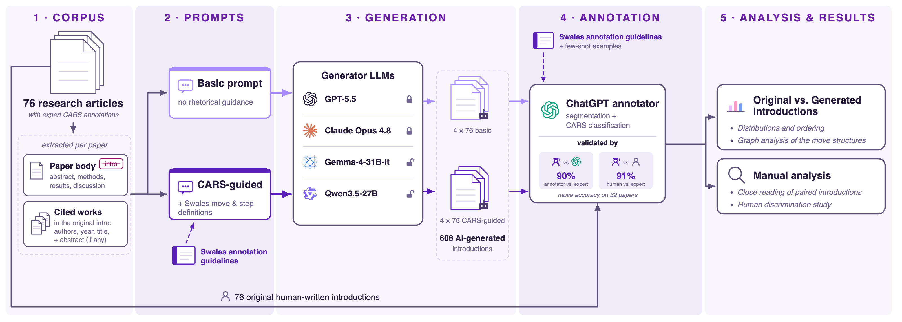
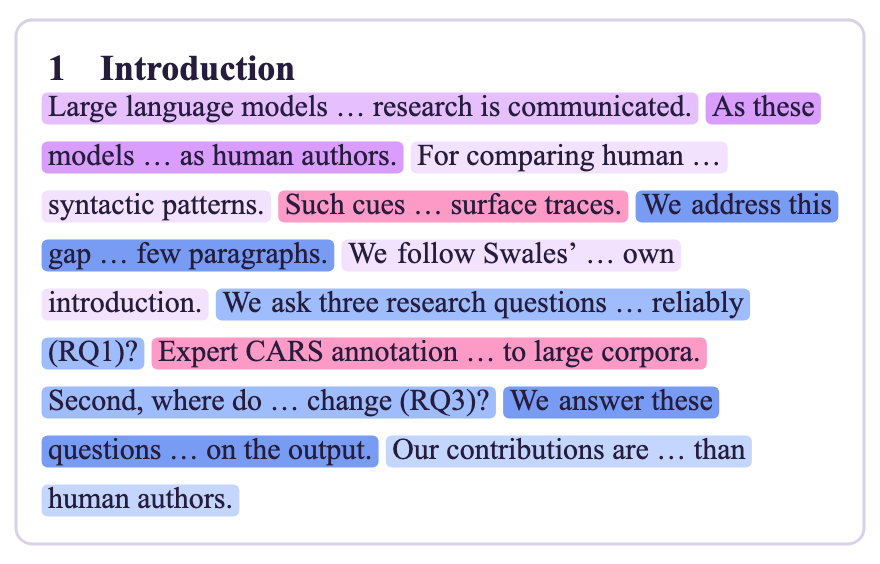
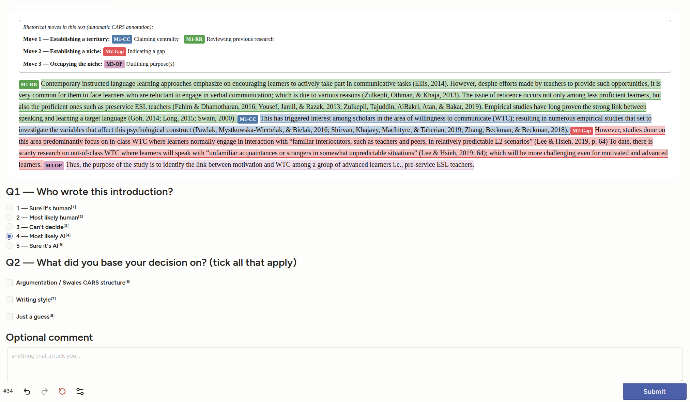

# Does AI-Generated Scientific Text Follow Human Argumentation Patterns?

### A CARS-Based Comparison of Research Article Introductions

<p align="center">
  <a href="https://arxiv.org/abs/2610.01353"></a>
  <a href="https://2027.eacl.org/"></a>
  <a href="https://usi-nlp.github.io/eacl2027-rhetoric-moves/"></a>
  <a href="https://arxiv.org/pdf/2610.01353"></a>
  <a href="data/"></a>
  <a href="LICENSE"></a>
  <a href="https://www.python.org/"></a>
</p>

<p align="center">
  <a href="https://bodasadallah.github.io/">Abdelrahman Sadallah</a>,
  Narjes Sheikh Asadi,
  <a href="https://sites.google.com/site/lonnekenlp/Home">Lonneke van der Plas</a>
  <br>
  <a href="https://usi-nlp.github.io/">USI NLP Lab</a> | <a href="https://www.usi.ch/en">Università della Svizzera italiana (USI)</a>
</p>

<p align="center">
  
</p>

<p align="center"><em>
From each of the 76 corpus papers we reconstruct the content and the works cited in the original introduction.
Four LLMs write each paper's introduction under a basic and a CARS-guided prompt, giving 608 generated introductions.
An automatic annotator then labels all original and generated introductions with CARS moves and steps,
and these labels feed the comparison and the manual analysis.
</em></p>

Large language models are moving from helping write up research to helping do it, which makes it important to know how the scientific text they produce differs from human writing. Work on this question has stayed mostly at the surface, using lexical and stylistic cues that light paraphrasing erases. We look instead at **rhetorical structure**, the sequence of argumentative moves through which a text makes its case. We study research-article introductions under Swales' CARS model, and compare original introductions from published linguistics articles with generated counterparts of the same papers. We find that human-written introductions are more flexible in which moves they use and in what order, while the generated ones are more uniform. Giving the models the CARS definitions makes them more rigid.

This repository contains the code, the prompts, the dataset and the human-study materials of the paper.

Contact: [Abdelrahman Sadallah](https://bodasadallah.github.io/), or open an [issue](https://github.com/usi-nlp/eacl2027-rhetoric-moves/issues).

---

## :fire: News

- [11-2026] Code and data released.
- [11-2026] The paper was accepted to **Findings of EACL 2027**.

---

## Contents

- [Key findings](#key-findings)
- [The CARS model](#the-cars-model)
- [Project structure](#project-structure)
- [Setup](#setup)
- [Dataset](#dataset)
- [Reproducing the paper](#reproducing-the-paper)
- [Running the full pipeline](#running-the-full-pipeline)
- [Citation](#citation)
- [License](#license)

---

## Key findings

| | Human originals | LLM-generated |
|---|---|---|
| Distinct moves used per introduction (of 3) | 2.67 | 2.93 - 3.00 |
| Distinct steps used per introduction (of 10) | 5.3 | 6.1 - 7.4 |
| Share of segments in Move 2 (establishing a niche) | 16.0% | 14.6 - 26.6% (above the human share in 7 of 8 sets) |
| Opens by claiming centrality | 46% | 58 - 84% |
| Opens with Move 3 | 2 of 76 | 0 of 608 |
| Distinct move structures across the 76 papers | 36 | 8 - 35 |
| Self-similarity of the source's own introductions (step edit similarity) | 0.33 | 0.37 - 0.46 |

- **Models cover the scheme, humans select from it.** 28% of the original introductions leave out an entire move. Where the original establishes no niche, states no explicit gap or never claims centrality, 86 - 96% of its generated counterparts add the missing step.
- **Generated introductions are more uniform.** Every model settles into a narrower range of move sequences than the human authors, and the step-level edit similarity between a generated introduction and the original of the same paper never exceeds 0.43 on average.
- **CARS guidance makes it worse.** Giving a model the move and step definitions pushes all four models further toward the canonical 1-2-3 template and away from the human structure. The number of distinct move structures drops for every model (ChatGPT 18 to 9, Claude 24 to 11, Gemma 14 to 8, Qwen 35 to 25).
- **The automatic annotator is close to a human annotator.** It reaches 92% of the human step accuracy (0.694 vs. 0.752) and is at the human baseline on moves (0.901 vs. 0.911) and on boundaries (F1 0.725 vs. 0.756).
- **Readers can use the structure.** A blind reader who knew the CARS model told original from generated introductions in 108 of 120 cases (90%), naming the argumentation structure as the basis on 118 of them. All 30 CARS-guided generations were caught, against 24 of the 30 basic ones.

---

## The CARS model

Swales' Create-A-Research-Space (CARS) model describes an introduction through three rhetorical moves, each realised by smaller steps. The annotation scheme of the paper has 3 moves and 10 steps:

| Move | Steps |
|---|---|
| **Move 1**: Establishing a territory | Claiming centrality (CC), Making topic generalizations (MTG), Reviewing items of previous research (RR) |
| **Move 2**: Establishing a niche | Continuing a tradition (CT), Indicating a gap (Gap), Question raising (QR) |
| **Move 3**: Occupying the niche | Announcing present research (APR), Announcing principal findings (APF), Indicating the structure of the research (IS), Outlining purpose (OP) |

<p align="center">
  
</p>

<p align="center"><em>
The CARS steps on the paper's own introduction. Hue marks the move (purple: Move 1, magenta: Move 2, blue: Move 3), shade marks the step.
</em></p>

The annotation manual that both the human annotators and the automatic annotator follow is in [`guidelines/`](guidelines/).

---

## Project structure

```text
eacl2027-rhetoric-moves/
├── README.md
├── LICENSE                             # CC BY-NC-SA 4.0
├── CITATION.cff
├── requirements.txt                    # analysis + LLM clients
├── requirements-extra.txt              # PDF preprocessing, model serving, study hosting
├── .env.example                        # API keys template
│
├── data/
│   ├── master_dataset.json             # 76 papers x 9 introductions + all CARS annotations
│   └── README.md                       # dataset card: fields, coverage, provenance
│
├── guidelines/
│   ├── Swales_CARS_Annotation_Manual.md    # the manual, embedded verbatim in the prompts
│   └── Swales_CARS_Annotation_Manual.pdf
│
├── data_processing/                    # Step 1: from article PDFs to the master dataset
│   ├── process_pdfs_docling_and_refs.py    # PDF to text with Docling
│   ├── extract_references_grobid.py        # reference lists with GROBID
│   ├── augment_references_with_abstracts.py # abstracts from OpenAlex / Crossref
│   ├── enrich_references_metadata_llm.py   # metadata from a cascade of scholarly APIs
│   ├── add_citation_contexts.py            # which references each introduction cites
│   ├── citation_review_app.py              # small web app for the manual citation check
│   ├── extract_introductions.py            # paper body without its introduction
│   ├── convert_swales_xml_to_labelstudio.py # gold XML annotations to Label Studio tasks
│   ├── build_master_dataset.py             # merge everything into data/master_dataset.json
│   └── export_gold_tasks.py                # gold annotations back out of the master dataset
│
├── intro_generation/                   # Step 2: LLM-written introductions
│   ├── prompts.py                          # basic and CARS-guided system prompts
│   ├── generate_intros.py                  # generation (OpenAI, Anthropic, OpenAI-compatible)
│   ├── patch_run_papers.py                 # splice regenerated papers into a run
│   ├── vllm_serve.sh, vllm_serve.slurm     # serve an open-weight model with vLLM
│   ├── run_vllm_generation.sbatch          # serve + generate for Gemma and Qwen
│   └── regen_qwen_cars_guided.sbatch       # rerun of the 9 failed Qwen generations
│
├── intro_analysis/                     # Step 3: the automatic CARS annotator
│   ├── prompts.py                          # annotator prompts, versions v1 - v8
│   ├── few_shot_rationales.json            # rationales of the few-shot demonstrations
│   ├── llm_client.py                       # multi-provider client with prompt caching
│   ├── run_experiment.py                   # annotate gold-labelled introductions
│   ├── evaluate_and_visualize.py           # boundary F1, WindowDiff, Pk, label metrics, HTML view
│   ├── postprocess.py                      # label mapping and the citation post-processor
│   ├── generate_fewshot_rationales.py      # write the demonstration rationales
│   ├── annotate_master_dataset.py          # annotate all 684 introductions (Batch API)
│   ├── build_unified_annotations.py        # merge the two second annotators
│   ├── build_human_runs.py                 # score the second annotators like a model run
│   └── validate_evaluator.py               # annotator vs. human baseline (32 papers)
│
├── comparative_analysis/               # Step 4: original vs. generated
│   ├── move_data.py                        # shared loader, applies the merge convention
│   ├── distribution_analysis.py            # move and step distributions
│   ├── sequence_analysis.py                # ordering, cyclicity, repertoire, quartiles
│   ├── graph_analysis.py                   # edit and bag similarity, diversity
│   ├── significance_tests.py               # paired tests, FDR, bootstrap CIs
│   ├── collapse_impact.py                  # sensitivity to the merge convention
│   ├── make_tables.py                      # rows of the paper's tables
│   ├── export_page_data.py                 # data of the project page's interactive figure
│   └── outputs/                            # the statistics behind the paper, as JSON
│
├── discrimination_experiment/          # Step 5a: human detection study
│   ├── build_allocation.py                 # sample 60 papers, 2x2 design, presentation order
│   ├── allocation.json                     # the key: which item is which
│   ├── judge_manifest.json                 # the blinded item list the judge saw
│   ├── build_labelstudio_project.py        # Label Studio project (the interface used)
│   ├── build_static_ui.py                  # self-contained HTML alternative
│   ├── build_argilla_datasets.py           # Argilla alternative, and the shared renderer
│   ├── labelstudio/                        # the study materials as shown to the judge
│   ├── convert_labelstudio_export.py       # export to responses.json
│   ├── responses.json                      # the judge's 120 blinded answers
│   ├── analyze_human_arm.py                # accuracy, signal detection, regressions
│   └── outputs/                            # report and full results
│
├── qualitative_experiment/             # Step 5b: expert close reading
│   ├── select_papers.py                    # choose the papers for both readings
│   ├── selection.json
│   ├── build_exp1_static_app.py            # original vs. basic vs. CARS-guided triplets
│   ├── build_exp2_static_app.py            # introductions of CARS-aware authors
│   ├── render_verify.py                    # check that rendered text equals source text
│   ├── exp1_close_reading/                 # the reading app, as used
│   └── exp2_swales_aware/
│
└── docs/                               # project page (GitHub Pages)
    ├── index.html
    └── static/                             # styles, scripts, figures (also used in this README)
```

---

## Setup

Python 3.10 or newer. The analyses were tested with Python 3.12.

```bash
git clone https://github.com/usi-nlp/eacl2027-rhetoric-moves.git
cd eacl2027-rhetoric-moves

python -m venv .venv && source .venv/bin/activate
pip install -r requirements.txt
```

`requirements.txt` covers the analyses and the LLM clients. `requirements-extra.txt` adds the tools for the steps that start from the article PDFs and for hosting the human studies. They are not needed to reproduce the numbers of the paper.

To call a model, copy `.env.example` to `.env` and fill in the keys you need. All scripts are run from the repository root.

---

## Dataset

[`data/master_dataset.json`](data/master_dataset.json) holds everything the analyses use: for each of the 76 papers, the original introduction, the eight generated introductions and every CARS annotation of those texts.

| | |
|---|---|
| Papers | 76 applied-linguistics research articles, stratified by journal quartile (Q1: 16, Q2 - Q4: 20 each) |
| Introductions | 684 = 76 original + 608 generated |
| Generators | GPT-5.5, Claude Opus 4.8, Gemma-4-31B-it, Qwen3.5-27B |
| Prompt settings | `basic`, `cars_guided` |
| Annotations | automatic on all 684, expert gold on the 76 originals, second-annotator labels on 32 originals |

```python
import json

data = json.load(open("data/master_dataset.json"))
paper = data["papers"][0]

for intro in paper["intros"]:
    moves = [seg["move"] for seg in intro["annotations"]["chatgpt"]["segments"]]
    print(intro["intro_id"], intro["word_count"], moves)
```

Key fields of an introduction:

| Field | Description |
|---|---|
| `intro_id` | `001_original`, `001_gpt-5.5_basic`, `001_claude-opus-4-8_cars_guided`, ... |
| `intro_type` | `original` or `generated` |
| `model`, `mode` | Generator and prompt setting (`null` for originals) |
| `text` | The introduction. All annotation offsets refer to this string |
| `annotations.chatgpt` | The automatic annotator, on every introduction. This is the annotation every analysis uses, on both sides of the comparison |
| `annotations.expert` | Expert gold annotation, on the originals |
| `annotations.annotator_1`, `annotations.annotator_2` | Second human annotators, 16 originals each |

Every annotation is a list of segments with `start`, `end`, `text`, `label` (`move_1__claiming_centrality`, ...), `move` and `step`. The full field reference is in the [dataset card](data/README.md).

The original introductions and their gold annotations come from the corpus of [D'Agostino, Sheikh Asadi and Musi (LREC 2026)](https://doi.org/10.63317/3cbozhs8zty6).

---

## Reproducing the paper

Every number below is computed from `data/master_dataset.json` alone. No API key and no GPU are needed.

| Command | Reproduces | Output |
|---|---|---|
| `python intro_analysis/validate_evaluator.py` | Annotator vs. human baseline, and per-class F1 | `intro_analysis/results/evaluator_validation_32papers.json` |
| `python comparative_analysis/make_tables.py` | Rows of the descriptive-statistics, move/step distribution and graph-similarity tables, plus checks of the numbers quoted in the text | console |
| `python comparative_analysis/distribution_analysis.py` | Move and step distributions: incidence, frequency, text share | `outputs/distribution_stats.json` |
| `python comparative_analysis/sequence_analysis.py` | Step ordering profile, cyclicity, repertoire, quartile breakdown | `outputs/sequence_stats.json` |
| `python comparative_analysis/graph_analysis.py` | Edit and bag similarity to the original, self-similarity, distinct structures | `outputs/graph_diversity.json`, `outputs/graph_similarity.json` |
| `python comparative_analysis/significance_tests.py` | The significance stars of the tables (Wilcoxon, McNemar, FDR) | `outputs/significance_tests.json` |
| `python comparative_analysis/collapse_impact.py` | Sensitivity of the results to the merge convention | `outputs/collapse_impact.json` |
| `python discrimination_experiment/analyze_human_arm.py` | Human detection study | `discrimination_experiment/outputs/` |

The `outputs/` paths in the first rows are under `comparative_analysis/`. The JSON files there are the ones the paper was written from. Rerunning a script overwrites them with values that are identical up to floating-point noise. Run `graph_analysis.py` before `make_tables.py` if you delete them.

One convention applies throughout: consecutive segments with the same step label are merged into one unit before anything is counted, so a new segment always marks a change of rhetorical function. `comparative_analysis/move_data.py::load_intros` applies it.

---

## Running the full pipeline

The steps below rebuild the study from the article PDFs. Steps 1 and 2 need the articles themselves: the PDFs, their parsed full texts and their reference lists are not redistributed. The corpus papers are listed by title in `data/master_dataset.json`, all are publicly accessible online, and the scripts expect them under `data/raw_data/`. Steps 3 to 5 run on the released dataset.

### 1. Preprocessing: from PDFs to generation context

Install `requirements-extra.txt` first. Each paper is converted to text, its reference list is parsed, and the works cited in its introduction are identified and enriched with metadata and abstracts.

| Stage | Script | Reads | Writes (under `data/raw_data/`) |
|---|---|---|---|
| PDF to text | `process_pdfs_docling_and_refs.py` | `raw_pdfs/` | `pdf_parsing_docling/` |
| Reference lists | `extract_references_grobid.py` | `raw_pdfs/` | `references_json_grobid/` |
| Abstracts | `augment_references_with_abstracts.py` | reference JSONs | updated in place |
| Metadata | `enrich_references_metadata_llm.py` | reference JSONs | updated in place |
| Citations of each introduction | `add_citation_contexts.py` | reference JSONs, corpus spreadsheet | `references_json_with_citations/` |
| Manual citation check | `citation_review_app.py` | the folder above | corrected in place |
| Generation context | `extract_introductions.py` | `pdf_parsing_docling/` | `processed_texts/` (paper body without its introduction) |
| Master dataset | `build_master_dataset.py` | all of the above, annotations, generation and annotation runs | `data/master_dataset.json` |

```bash
# PDF to text (Docling). Add --docling-cpu-only without a GPU
python data_processing/process_pdfs_docling_and_refs.py \
    --pdf-dir data/raw_data/raw_pdfs \
    --text-dir data/raw_data/pdf_parsing_docling --text-only

# Structured reference lists (GROBID must be running)
docker run --rm --init --ulimit core=0 -p 8070:8070 grobid/grobid:0.9.0-crf
python data_processing/extract_references_grobid.py \
    --pdf-dir data/raw_data/raw_pdfs \
    --refs-dir data/raw_data/references_json_grobid --include-raw-citations

# Abstracts and metadata for every reference
python data_processing/augment_references_with_abstracts.py \
    --refs-dir data/raw_data/references_json_grobid
python data_processing/enrich_references_metadata_llm.py \
    --refs-dir data/raw_data/references_json_grobid --mailto you@example.org
```

The remaining stages take the folders shown in the table. Every script documents its inputs and options in its docstring. The corpus spreadsheet with the paper metadata and the introduction texts is part of the source corpus (see [Dataset](#dataset)).

### 2. Generating introductions

Each model receives the paper's title and body (with the original introduction removed), the works cited in the original introduction, and a length target equal to the original's length. The two settings differ only in the system prompt ([`intro_generation/prompts.py`](intro_generation/prompts.py)): `basic` asks for an introduction, `cars_guided` adds the CARS move and step definitions and asks the model to plan the moves before writing.

```bash
# Commercial models, through the Batch APIs
python intro_generation/generate_intros.py --all --model gpt-5.5 --mode basic --batch
python intro_generation/generate_intros.py --all --model claude-opus-4-8 --mode cars_guided --batch
python intro_generation/generate_intros.py --fetch-batch intro_generation/results/<run_dir>

# Open-weight models, served locally with vLLM
MODEL=Qwen/Qwen3.5-27B bash intro_generation/vllm_serve.sh
OPENAI_COMPAT_BASE_URL=http://localhost:8000/v1 \
python intro_generation/generate_intros.py --all --mode basic \
    --provider openai_compatible --model Qwen/Qwen3.5-27B
```

`run_vllm_generation.sbatch` does the serving and the generation for both open-weight models in one SLURM job. Each run writes `generated_intros.json`, a `texts/` folder and `run_meta.json` under `intro_generation/results/`.

### 3. Automatic CARS annotation

The annotator takes a whole introduction and returns an ordered list of segments, each with a one-sentence rationale and a step label. Its system prompt embeds the annotation manual, a set of operational clarifications and three worked gold examples. The validated configuration is prompt version `v8` with `gpt-5.5` at low reasoning effort.

The worked examples are read from a gold task file, which is rebuilt from the master dataset:

```bash
python data_processing/export_gold_tasks.py     # writes data/annotation/human_intros/tasks.json
```

**Annotate your own introduction:**

```python
from dotenv import load_dotenv

from intro_analysis.llm_client import LLMClient, parse_json
from intro_analysis.postprocess import map_numeric_labels
from intro_analysis.prompts import USER_PROMPT_TEMPLATE, get_system_prompt
from intro_analysis.run_experiment import load_tasks

load_dotenv()
tasks = load_tasks("data/annotation/human_intros/tasks.json")
system_prompt = get_system_prompt(mode="classification", few_shot=True,
                                  source="manual", all_tasks=tasks, version="v8")

text = " ".join(open("my_introduction.txt").read().split())    # collapse whitespace
client = LLMClient("gpt-5.5", reasoning_effort="low")
reply = parse_json(client.generate(system_prompt, USER_PROMPT_TEMPLATE.format(text=text)))

segments = reply["segments"]
map_numeric_labels(segments)                # class numbers to label strings such as
                                            # move_1__claiming_centrality (Move 2 keeps the
                                            # source spelling, moves_2__indicating_a_gap)
for seg in segments:
    print(seg["label"], "|", seg["text"][:70])
```

**Annotate the whole dataset** (OpenAI Batch API):

```bash
python intro_analysis/annotate_master_dataset.py --submit
python intro_analysis/annotate_master_dataset.py --status <run_dir>
python intro_analysis/annotate_master_dataset.py --fetch  <run_dir>
python intro_analysis/annotate_master_dataset.py --merge  <run_dir>   # into data/master_dataset.json
```

**Develop or compare annotator prompts** on the gold-labelled originals:

```bash
python intro_analysis/run_experiment.py --n 10 --mode classification --few-shot \
    --prompt-source manual --prompt-version v8 --no-citation-postproc
python intro_analysis/evaluate_and_visualize.py      # scores the latest run, writes an HTML view
```

`PROMPT_VERSIONS` in [`intro_analysis/prompts.py`](intro_analysis/prompts.py) lists what each prompt version changed.

### 4. Comparing original and generated introductions

See [Reproducing the paper](#reproducing-the-paper). All scripts in `comparative_analysis/` read the master dataset and use the automatic annotation on both sides, so that the annotator is not a confound in the comparison.

### 5. Human studies

**Detection study.** One blind reader judged 120 introductions, 60 originals and 60 Claude generations of the same papers, in a 2x2 design: prompt setting of the generated item, crossed with whether the move annotations were shown.

```bash
python discrimination_experiment/build_allocation.py           # design and key, from a fixed seed
python discrimination_experiment/build_labelstudio_project.py  # the interface the judge used
python discrimination_experiment/analyze_human_arm.py          # results from responses.json
```

`build_allocation.py` reproduces `allocation.json` exactly, and `build_labelstudio_project.py` reproduces the files in `labelstudio/`.

<p align="center">
  
</p>

**Close reading.** An expert in the CARS framework read five papers as triplets (original, basic, CARS-guided) and four originals whose authors themselves write about the CARS model. The two reading apps are single HTML files that open in any browser:

```bash
python qualitative_experiment/select_papers.py
python qualitative_experiment/build_exp1_static_app.py    # exp1_close_reading/index.html
python qualitative_experiment/build_exp2_static_app.py    # exp2_swales_aware/index.html
```

---

## Citation

If you use the code or the data, please cite the paper:

```bibtex
@misc{sadallah2026carsintroductions,
    title         = {Does AI-Generated Scientific Text Follow Human Argumentation Patterns? A CARS-Based Comparison of Research Article Introductions},
    author        = {Abdelrahman Sadallah and Narjes Sheikh Asadi and Lonneke van der Plas},
    year          = {2026},
    eprint        = {2610.01353},
    archivePrefix = {arXiv},
    primaryClass  = {cs.CL},
    url           = {https://arxiv.org/abs/2610.01353},
    note          = {To appear in Findings of the Association for Computational Linguistics: EACL 2027}
}
```

---

## License

This repository is licensed under a [Creative Commons Attribution-NonCommercial-ShareAlike 4.0 International License](LICENSE) (CC BY-NC-SA 4.0). This covers the code, the annotations, the generated introductions and the human-study data.

Two parts are not ours to license:

- **Original introductions.** They are excerpts of published articles, remain the property of their authors and publishers, and are included for research purposes only. If you are a rights holder and want a text removed, please open an issue.
- **Project page.** The page in `docs/` is built on the [Academic Project Page Template](https://github.com/eliahuhorwitz/Academic-project-page-template) (CC BY-SA 4.0) and uses [Bulma](https://bulma.io) and [Feather](https://feathericons.com) icons (both MIT).

> This repository contains experimental software and is published for the sole purpose of giving additional background details on the respective publication.
